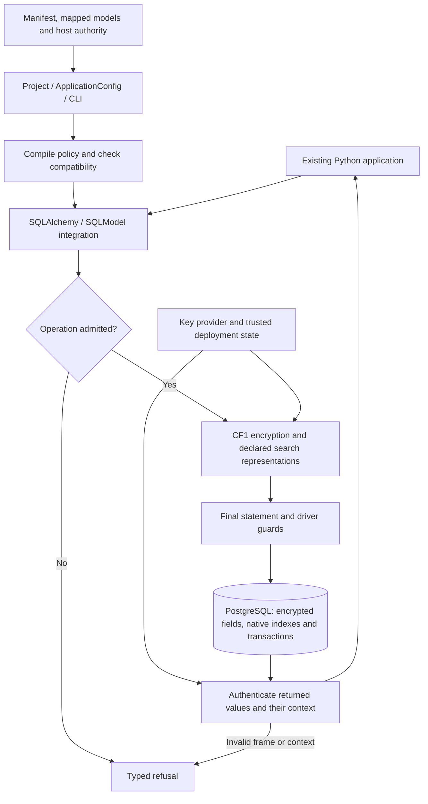
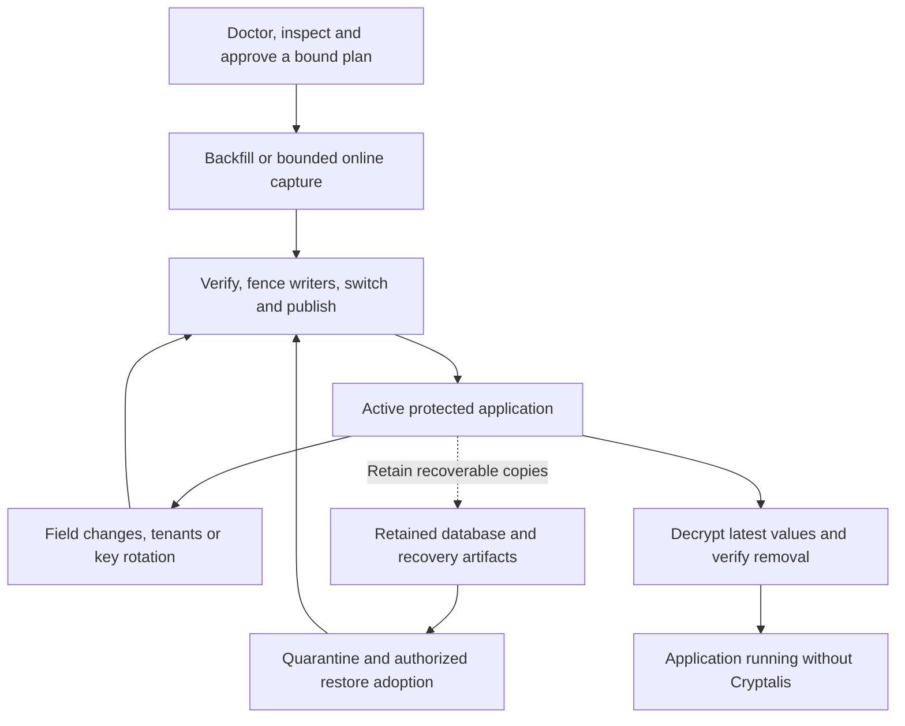
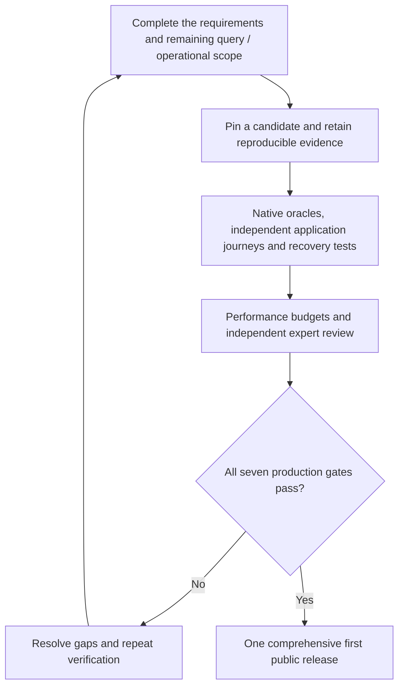

# Cryptalis

**Searchable encryption for Python applications using PostgreSQL.**

Cryptalis is building a way to protect sensitive database fields while keeping
ordinary application code, useful queries and a clear path to recovery. A manifest
declares which fields need protection. The library handles encryption, admitted
queries and lifecycle operations inside the Python application process.

**Research prototype; not production-security-qualified.** The goal is one
comprehensive first public release covering the [18 requirements](docs/requirements.md)
and [34 objectives](docs/BUILD_CHECKLIST.md). The implementation is progressing
toward that goal; all seven production gates remain **UNKNOWN**.

## Research question

Can application-layer encryption preserve useful PostgreSQL and ORM behavior,
make search leakage explicit, and support rotation, recovery and eventual removal
without losing the application's current data?

The project studies that question through a working Python library, native
PostgreSQL comparisons and real application journeys. Its central design choices are:

- **Declare intent once:** a manifest connects protected fields, tenancy and search policy.
- **Encrypt before storage:** protected values are sealed in the application process.
- **Keep useful database work:** PostgreSQL still provides transactions, constraints and indexes.
- **Make security decisions visible:** search leakage, tenant authority and writer exclusion require explicit inputs.
- **Plan the whole lifecycle:** adoption, field changes, key rotation, restore and removal belong to the design.

## How it fits together



The host authenticates users, supplies tenant scope and controls deployment
authority. PostgreSQL stores the protected representation and public row context.
The key provider controls root custody. Encryption and authentication happen
inside the application. See the [architecture](docs/architecture/README.md) for
the exact boundaries.

## Cryptographic method and its limits

The CF1 format uses **AES-256-GCM-SIV**, fresh 12-byte operating-system nonces,
**HKDF-SHA-256** key derivation and independent payload and search roots.
Authentication binds a value to its expected tenant, field, record, descriptor
and frame header. Declared exact search uses full **HMAC-SHA-256** terms.
The [format specification](docs/security.md#cryptographic-format) and
[implementation](src/cryptalis/crypto/cf1.py) define the precise encoding.

| Field policy | Database behavior | Information still exposed |
|---|---|---|
| Storage only | Store and retrieve authenticated encrypted values | Length, NULL presence and public row structure |
| Exact search | Declared equality, `IN` and scoped uniqueness | Equality and frequency within the search scope |
| Opt-in order search | Admitted integer, date and timestamp range/sort operations | Order, equality and frequency |

Search is a deliberate trade-off. The host must accept its leakage before use.
Returned-value authentication does not prove that a hostile database returned
every row or the newest version. Application compromise, copied keys and plaintext
in older backups remain outside that protection. NULL presence is not authenticated
by the default profile. Read the [threat model and leakage contract](docs/security.md)
before selecting a field policy.

## What works today

These are bounded implementation capabilities, with revision-specific evidence
in [current status](docs/status.md). The [compatibility matrix](docs/compatibility.md)
defines the exact supported types, operations and restrictions.

| Area | Implemented scope |
|---|---|
| Application integration | Sync/async SQLAlchemy and optional SQLModel through guarded sessions |
| Storage | Text, Boolean, signed integers, dates, timestamps, UUID, finite numeric and bounded native JSONB |
| Search | Declared exact/`IN`/scoped uniqueness; opt-in order search on admitted types; whole-document JSONB equality |
| Writes | Admitted ORM CRUD, parameterized single-record UPDATE and bounded upsert |
| Operations | Doctor checks, resumable protection, field changes, tenant provisioning and three rotation workflows |
| Recovery and exit | Authorized fresh-cluster adoption, decrypting current values and verified removal workflows |
| Key custody | Development provider and optional AWS KMS, Google Cloud KMS and OpenBao adapters, each with separate evidence limits |

JSON path/containment, general prefix/fuzzy search and other unadmitted operations
remain unfinished work. Unsupported operations raise typed errors. There is no
plaintext fallback or hidden full-table decryption path for an unsupported query.

## From adoption to recovery and exit



Wrapping-key rotation, payload rotation and search-key rotation are distinct
operations. A restored database cannot authorize its own deployment: matching
plans, current host authority and recoverable key custody remain necessary.
Online capture initially retains native plaintext; confidentiality begins at
the protected representation switch. The [lifecycle contract](docs/lifecycle.md)
and [operator walkthrough](docs/walkthrough-migration.md) describe the checks,
resume behavior and remaining qualification gaps.

## Experimental evidence

Verification compares admitted operations against native PostgreSQL and exercises
source and normally installed packages. The retained application study protects
`User.email` in the original Smolink backend, checks login and uniqueness, rotates
keys, removes Cryptalis and repeats the journey after an actual uninstall.
The application evidence and failures are linked from [current status](docs/status.md).

For latency, native and protected modes alternate across two matched clusters
for three rounds of 512 samples. The table reports recorded added p95 latency
in milliseconds on a shared workstation, with warm development keys and one
protected field read. It excludes HTTP and remote-provider latency. The measured
wheel was built from `bd223c1`; these figures were not remeasured on the later wheel.

| Operation | Target | 1 process, concurrency 1 | 1 process, concurrency 4 | 4 worker processes |
|---|---:|---:|---:|---:|
| Email equality | 3 ms | 1.91 | 7.65 | 3.06 |
| Point read | 3 ms | 1.88 | 6.71 | 2.69 |
| `IN` with 20 values | 8 ms | 2.64 | 10.52 | 3.78 |

The narrow-read targets are met at concurrency 1. Higher concurrency and wider
protected reads remain a performance challenge. A separate diagnostic misses
3 ms at about ten protected fields. Column-plus-index storage measures **2.017×**
native after compaction, narrowly missing the 2× target. These are local observations,
not production guarantees. See [measurement scope and results](docs/status.md#real-application-equality-search)
for all cells, artifact identities and limitations.

## What we are building toward

The target is a complete, independently reviewed encryption library with broader
query coverage, predictable performance and qualified operational recovery.
Safe refusal keeps the current boundary explicit; it does not complete a missing
product objective.



The seven gates cover adapter behavior, cryptography, queries, lifecycle, provider
custody, deployment policy and release engineering. **All seven are currently
UNKNOWN.** The [objective ledger](docs/BUILD_CHECKLIST.md) tracks the remaining
work; [promotion criteria](docs/status.md#missing-evidence-and-promotion-criteria)
define the evidence needed. AI review and passing tests do not replace independent
human security review.

## Try the project

Use **Python 3.12 or 3.13**, **uv** and a disposable **PostgreSQL 16** environment.
From the checkout root:

```console
uv sync --frozen --all-extras
```

Follow [local development](docs/local-development.md) to provision an isolated
database and run the required role probes and qualification commands. For a full
process-by-process demonstration, [quickstart.py](examples/quickstart.py) covers
protection, ordinary queries, all three rotations and a restart after removal.
The [installation guide](docs/installation.md) covers normal wheel installation.

This integration sketch assumes your existing `Base` and `Customer` mappings,
a configured key provider, an owner engine and an authenticated tenant:

```python
from sqlalchemy import create_engine
from cryptalis import Project

project = Project(
    "cryptalis.json", Base.registry,
    provider=my_key_provider, state_dir="/etc/myapp/cryptalis",
)
project.doctor(owner_engine)
project.protect(
    owner_engine, runtime_role="app",
    writers_stopped="The deployment stopped the API and workers.",
    search_reviewed="The declared email search leakage was reviewed.",
)

engine = create_engine(app_url, hide_parameters=True)
SessionLocal = project.attach(engine)
with SessionLocal(tenant_id=authenticated_tenant) as session:
    customer = session.get(Customer, customer_id)
    customer.email = "new@example.com"
    session.commit()
```

Single-tenant applications call `SessionLocal()` without a tenant argument.
Keep trusted deployment state outside database backups. Use
`DevelopmentKeyProvider` only for synthetic data and retain its key file when
testing restarts. See [the application API](docs/application.md#project-the-small-api)
for configuration and operation-specific recovery behavior.

## Project guide

| Location | Purpose |
|---|---|
| [`src/cryptalis/`](src/cryptalis/) | Public API, compiler, ORM integration, cryptography and lifecycle executors |
| [`tests/`](tests/) and [`qualification/`](qualification/) | Native-oracle, integration and installed-package checks |
| [`examples/`](examples/) | Runnable application lifecycle example |
| [Documentation map](docs/README.md) | Architecture, manifest, walkthroughs and contract owners |
| [Status](docs/status.md) and [objective ledger](docs/BUILD_CHECKLIST.md) | Verified boundaries, unfinished work and production gates |
| [Research and prior art](docs/research/README.md) | Source-backed investigations and historical comparisons |
| [History](docs/history/README.md) and [`docs/_reset/`](docs/_reset/) | Revision-bound evidence and retained machine receipts |
| [Changelog](CHANGELOG.md) | Candidate changes and compatibility limits |

Before contributing, read [AGENTS.md](AGENTS.md) and the
[engineering playbook](ENGINEERING_PLAYBOOK.md). Cryptalis is licensed under the
[MIT License](LICENSE).
