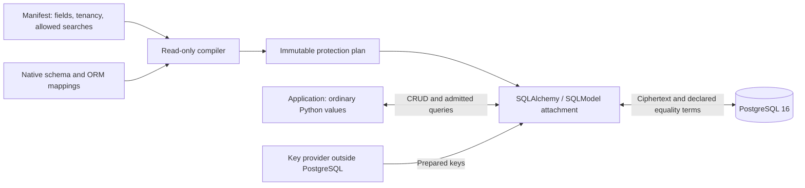
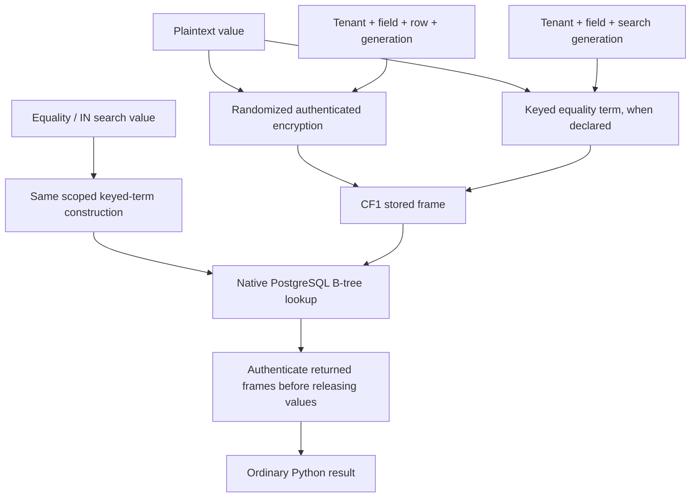
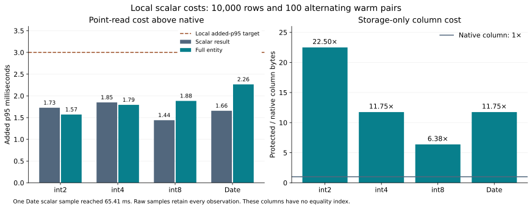
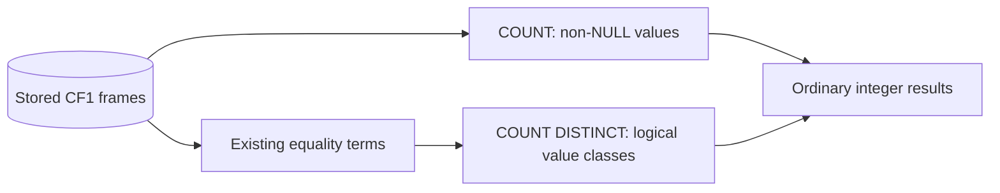
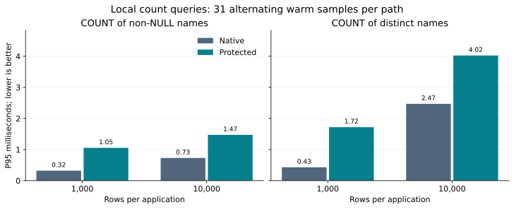
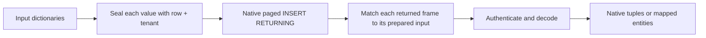
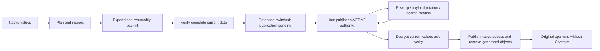
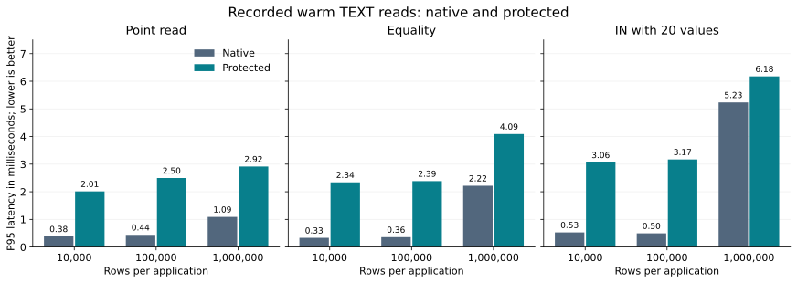
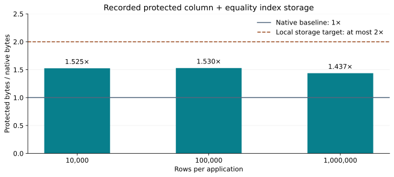
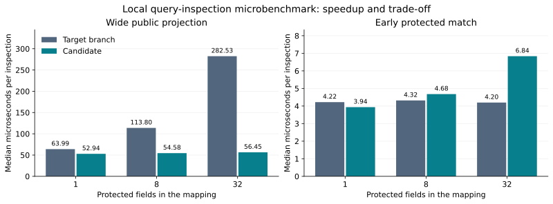

# Explaining Cryptalis

Cryptalis protects selected database columns inside a Python application. The
application still works with ordinary values. PostgreSQL stores authenticated
ciphertext and, for explicitly searchable fields, a keyed equality term.

This guide explains the college project. It does not change the production
requirements in [status](status.md) or mark an unfinished objective complete.
Live provider qualification and independent security reviews are outside the
assignment demonstration.

## The problem

A database dump normally reveals values such as names and email addresses.
Encrypting those values hides their contents, but ordinary database equality
and unique indexes then stop working. Cryptalis keeps a bounded set of those
operations available while moving encryption keys outside the database.

## Where protection happens



The manifest selects protection; it does not contain secret keys. The compiler
checks the schema and rejects incompatible plans. The attachment handles admitted
application operations. The transition engine changes the stored representation.
The host application still authenticates users and authorizes tenant access.

## Why equality still works



Randomized encryption produces different payloads for repeated values. The
equality term lets PostgreSQL find matching rows without receiving the search
plaintext. That term reveals equal-value groups, frequencies and query patterns.
The manifest requires explicit acceptance of this leakage. This is searchable
encryption with a stated trade-off, not a claim that database activity is hidden.

## What the implementation demonstrates

| Area | Recorded local behavior | Important boundary |
|---|---|---|
| Values | TEXT/VARCHAR and storage-only Boolean, signed integers, finite dates and UUIDs | Additional scalar/structured types and non-text searches remain pending |
| Search | Exact equality, IN, admitted NULL/negative forms and tenant-scoped uniqueness | Protected ranges, ordering, text patterns and general aggregates refuse |
| Reports | Non-NULL counts, one-tenant distinct counts, public count filters/windows and public DISTINCT with encrypted filters | General protected grouping, joins and other aggregate families remain pending |
| Application integration | Sync/async SQLAlchemy and a synchronous SQLModel bridge | Selected operations and mappings, not arbitrary SQL |
| Migration | Atomic resumable chunks, online text/scalar capture, verification and publication-gated cutover | Initial online capture still needs a final write pause |
| Recovery | Protected backups, fresh-cluster adoption and stale-authority refusal | Local fixtures do not establish production disaster-recovery targets |
| Key changes | Root rewrap, payload rotation and search rotation | A local provider and SDK controls do not establish live cloud custody |
| Exit | Latest-value decrypt-back, metadata restoration and package-free restart | Retained backups can still need old keys and readers |
| Delivery | CLI, Doctor, repeat builds and dependency inventory | No production-qualified release |

These statements summarize [implementation status](status.md), not new test runs.
The [34-objective ledger](BUILD_CHECKLIST.md#objective-ledger) retains the full
requirements and each remaining gap.

## Work still open

The repository's baseline is broader than this demonstration. These are actual
implementation gaps, even with production qualification excluded:

| Area | Remaining work |
|---|---|
| Protected queries | Ranges, ordering, exact text patterns, general grouping/joins and SUM/AVG/MIN/MAX |
| Types | Additional scalar and structured JSON contracts |
| Integration | Broader UPDATE/DELETE RETURNING routes, upserts, trigger/cascade cases and automatic query/writer inventory |
| Migration | Multiple database executors and online coverage for future types |
| Measurements | Cold and saturated workloads, larger concurrent profiles, resource limits and pause/recovery budgets |

These features need their own stored representations, query contracts or
integration work. The counts added here reuse existing storage. Live provider
qualification, production deployment assurance and independent security review
remain outside the college demonstration.

## Dates and small scalar values

An ordinary Python `date` stays a date through protection, reads, edits, rotation,
backup recovery and removal. The admitted date domain is years 1 through 9999.
PostgreSQL infinity, BC values and larger years refuse before migration effects.
The payload stores a four-byte ordinal inside the existing authenticated frame.
It adds no date equality or ordering term.



| Type | Scalar added p95, ms | Entity added p95, ms | Protected/native column bytes |
|---|---:|---:|---:|
| int2 | 1.73 | 1.57 | 22.50x |
| int4 | 1.85 | 1.79 | 11.75x |
| int8 | 1.44 | 1.88 | 6.375x |
| Date | 1.66 | 2.26 | 11.75x |
| UUID | 1.42 | 1.70 | 3.6875x |

Each 10,000-row profile has 100 alternating measured pairs after ten warmups,
real protection and publication, and current-value decrypt-back/removal. Every
value matches the native database after removal. The
[date receipt](_reset/scalar-cost-date-20261028.json) and integer receipts for
[int2](_reset/scalar-cost-int16-20261028.json),
[int4](_reset/scalar-cost-int32-20261028.json) and
[int8](_reset/scalar-cost-int64-20261028.json) retain all samples, process costs
and full-entity/public-ID batch observations.

These fields have no equality index. The column-only ratios do not evaluate the
2x indexed-column target. A Date occupies four native bytes; its authenticated
frame plus the PostgreSQL short bytea header occupies 47 bytes in this fixture.
The fixed authentication cost therefore dominates small values. One Date point
sample reached 65.41 ms. The p95 result does not hide that tail observation or
establish a concurrent/production guarantee.

UUID-valued fields store sixteen authenticated network-order bytes, including
the nil UUID. The [UUID profile](_reset/scalar-cost-uuid-20261028.json) uses the
same matched workloads in a separate run. Its CF1 frame and bytea header occupy
59 bytes versus sixteen native bytes. The UUID used as a record identity or
tenant identifier stays public so the application can authenticate each value
against its expected row and tenant.

## Count reports over encrypted values

`COUNT(column)` counts non-NULL stored values without decrypting every row.
For equality-enabled fields, `COUNT(DISTINCT column)` counts the existing equality
terms within one tenant. Randomized
ciphertexts are not used as distinct-value keys.

For the values `Ada`, `Ada`, NULL and an empty string, the row count is four,
the non-NULL count is three and the distinct non-NULL count is two.



The normal SQLAlchemy API and result keys remain available:

```python
present = func.count(Customer.name)
distinct_names = func.count(Customer.name.distinct()).label("distinct_names")
row = session.execute(select(present, distinct_names)).one()
non_null_total = row._mapping[present]
different_values = row.distinct_names
```

Public fields can also control the report without decrypting the protected column:

```python
eligible = func.count(Customer.name).filter(Customer.age >= 18)
running = func.count(Customer.name).over(order_by=Customer.id, rows=(None, 0))
```

The first expression counts non-NULL names for adults. The second reports a
running non-NULL count in public ID order. Protected filters and sort keys still
need their own query admission.

Use the attached session and declared single tenancy from the walkthrough.
For a tenant-column table, add a direct `Customer.tenant_id == tenant_id` filter,
or group by `Customer.tenant_id` to report each tenant separately. A global
distinct count across tenants refuses because their terms are intentionally
different even when their plaintext values match.
Counts trust the database's aggregate result; they do not authenticate every
frame or prove that the database returned complete results. Other aggregate
families and general protected grouping remain unfinished objectives.

### Measured count cost



| Rows | Operation | Native p95, ms | Protected p95, ms |
|---:|---|---:|---:|
| 1,000 | Non-NULL count | 0.32 | 1.05 |
| 1,000 | Distinct count | 0.43 | 1.72 |
| 10,000 | Non-NULL count | 0.73 | 1.47 |
| 10,000 | Distinct count | 2.47 | 4.02 |

These [local paired samples](_reset/count-performance-20261028.json) compare
the same synchronous queries and data distribution on native text and attached
CF1 fixtures. Each path has five warmups and 31 alternating samples. Both return
909 or 9,090 non-NULL values and 257 distinct values. The query returns one
integer rather than transferring all names to Python for counting.

The [wrapper receipt](_reset/count-performance-wrapper-20261028.json) records
stable source hashes and three authenticated PostgreSQL role probes. This is a
loopback PostgreSQL 16.15 fixture measurement, not migration timing, a target-branch
speedup or a production performance guarantee. The original target branch
refused these protected counts.

## Distinct values and distinct rows

`select(Customer.email).distinct()` returns logical unique values through the
existing equality term. It needs declared equality and one provable tenant scope.
The chosen representative frame still authenticates before its value is returned.
SQL NULL appears once. This route currently has no ordering or pagination.

`select(Customer).distinct().order_by(Customer.id).limit(20)` selects the public
primary key as part of each row. That identity already distinguishes source rows,
so Cryptalis can retain native DISTINCT, public ordering and pagination. This
route also works for storage-only Date/Boolean/text fields. Repeated join rows
collapse correctly. Another alias's ID cannot establish that identity.

These are different SQL requests. Selecting an ID keeps separate records even
when their protected values match. General protected grouping, caller DISTINCT ON
and value ordering still require further work.

## Returning inserted records

Applications can insert dictionaries and receive the inserted entity directly:

```python
rows = session.scalars(
    insert(Customer).returning(Customer, sort_by_parameter_order=True),
    [{"id": new_id, "tenant_id": tenant_id, "email": "student@example.test"}],
).all()
```

Direct tuples such as `.returning(Customer.id, Customer.email)` also retain native
Row keys. The adapter authenticates every protected output against the exact
frame it prepared for that input row. It keeps public fields and ORM identity
loading native. Paging and heterogeneous parameter groups need no per-row query.
Labels, expressions, loader options and caller return_defaults still refuse.



## A reversible lifecycle

Online capture can use up to sixteen cryptographic workers while one SQL writer
commits each row batch and its progress atomically. An optional duration target
adapts the next row count within the manifest plan's row and byte ceilings.
This preserves the existing capture/fence/resume workflow. The functional
concurrency checks do not claim a measured speedup or eliminate the final pause.



The distinction between switching the database and publishing application
authority is deliberate. An interrupted switch must not silently authorize
mismatched workers. Reverse migration uses current committed values, so edits
made after protection survive removal.

## Performance evidence

The repository records matched native and protected read profiles at 10,000,
100,000 and 1,000,000 rows. Each workload uses ten warmup pairs and 100 measured
pairs with alternating execution order. The recorded local warm TEXT workloads
meet their read-latency and isolated column-plus-equality-index storage targets.



The bars show complete native and protected p95, not just encryption CPU time.
These are separate historical profiles at different source revisions, not a
controlled scaling experiment or a before/after benchmark of this PR.



| Recorded fixture | Source revision | Raw evidence |
|---|---|---|
| 10,000 rows | `4f11600` | [Latency samples and storage](_reset/performance-current-20261023.json) |
| 100,000 rows | `c7cc47d` | [Latency samples and storage](_reset/performance-100k-20261023.json) |
| 1,000,000 rows | `3bd4467` | [Latency samples and storage](_reset/performance-million-prepared-20261023.json) |

Regenerate both figures with `uv run scripts/render_performance.py`. Its plotting
dependency is isolated from the application environment and runtime package.

P95 is the value at or below which 95% of the measured requests fall. Added p95
means protected p95 minus native p95. It is not the p95 of pairwise differences.
Storage counts the protected column and its equality index; it is not total
database storage. A large percentage increase on a small native latency can
still be a small increase in milliseconds.

The receipts use local public fixture keys and revision-specific implementations.
They do not measure cloud key-provider latency or prove performance on every
workload. Earlier slower measurements and unresolved anomalies remain in
[compatibility](compatibility.md#performance-targets-and-recorded-costs).

## Query-inspection optimization

SQLAlchemy represents a query as a tree of expressions. Cryptalis inspects that
tree to find references to protected columns. The implementation now builds one
set of protected-column ancestors per inspection, then uses set intersections.
It avoids repeating a comparison against every protected field for every query
column. The set is rebuilt on each call; it is not a persistent query cache.



This [paired microbenchmark](_reset/admission-lineage-20261028.json) extracts the
original method from target commit `5d6ff65` and runs it alongside candidate
`c9a1049` in the same process. Each case has 100 warmups and 31 alternating
batches of 200 calls. Both methods must agree with the expected lineage results.

| Query shape with 32 protected fields | Target median, microseconds | Candidate median, microseconds |
|---|---:|---:|
| One public column | 7.60 | 3.65 |
| 32 public projection labels | 282.53 | 56.45 |
| First protected field matches | 4.20 | 6.84 |
| Last protected field matches | 11.02 | 6.88 |
| Public labels and a protected field | 36.87 | 32.86 |

The wide public projection improves substantially, while an early match can cost
more because the new method builds the complete lineage set first. One
millisecond is 1,000 microseconds. These are inspection costs, not whole-query
latency or encryption throughput. The receipt also includes the one-field and
eight-field cases, raw samples, interpreter versions and exact source hashes.

## Suggested demonstration

1. Explain the database-dump problem and the application/database trust boundary.
2. Show a declaration from the [SQLAlchemy walkthrough](walkthrough-sqlalchemy.md).
3. Explain the equality term and its leakage before showing a search.
4. Follow protection, a current-data edit, key rotation and decrypt-back.
5. Show the [recorded online application journey](status.md#original-online-http-fresh-recovery-2026-10-24).
6. Finish with the measured costs and the objective ledger's unfinished work.

Keep the distinction between a design, implemented code and recorded verification
visible. A refused unsupported query is a useful correctness demonstration, but
it does not mean that query capability has been implemented.

Use the [local run guide](local-development.md) to reproduce the checks and
regenerate the figures without configuring a cloud account.
